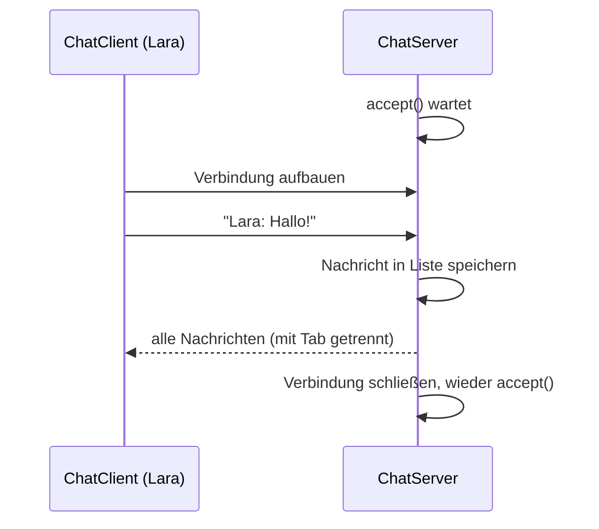
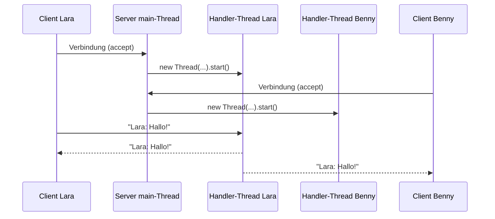

# Java: Threads & Chat-Server

Übungen für die Klausur in Datenkommunikation (Client-Server-Programmierung, Threads, Sequenzdiagramme).

| Ordner | Inhalt |
|---|---|
| `seite494-498_ThreadTestlauf` | Buch S. 494 / 498: `MeinRunnable` + `ThreadTestlauf`, die Reihenfolge der Ausgabe ist zufällig |
| `seite502_ThreadSleep` | Buch S. 502: dasselbe Programm mit `Thread.sleep(2000)`, die Reihenfolge ist jetzt vorhersagbar |
| `seite503_ZweiThreads` | Buch S. 503: zwei Threads (Alpha/Beta) mit demselben Runnable |
| `unterricht_1_extendsThread` | Unterricht: `MeinThread extends Thread` + `MeinThreadStart` (Hinweis: immer `start()` aufrufen, nie `run()` direkt) |
| `unterricht_2_Runnable` | Unterricht: `MeinRunnable implements Runnable` + `MeinThreadMitRunnableStart` |
| `unterricht_3_RunnableEins` | Unterricht: `MeinRunnableEins` gibt den Thread-Namen aus. Die Startklasse `MeinRunnableEinsStart` habe ich ergänzt |
| `chat_einfach` | Arbeitsblatt Chat-Server: einfacher `ChatServer` (Schleife mit `accept()`) + `ChatClient` |
| `chat_threads` | Erweiterungen: `ThreadChatServer`, `ThreadChatClient` (Konsole) und `ChatClientGUI` (Swing) |

## Kompilieren und starten

In den jeweiligen Ordner wechseln:

```bash
javac -encoding UTF-8 *.java
java ThreadTestlauf        # bzw. ZweiThreads
```

### Einfacher Chat (Arbeitsblatt)

Drei Konsolenfenster öffnen, im Ordner `chat_einfach`:

```bash
java ChatServer            # Fenster 1, Port 5000
java ChatClient            # Fenster 2 (z. B. Lara)
java ChatClient            # Fenster 3 (z. B. Benny)
```

Läuft der Server auf einem anderen Rechner: `java ChatClient <IP-Adresse> [Port]`.
Beim Client: Text eingeben und Enter drücken, um eine Nachricht zu senden. Nur Enter holt die neuen Nachrichten ab.

### Chat mit Threads

Im Ordner `chat_threads`:

```bash
java ThreadChatServer
java ThreadChatClient      # Konsole, beenden mit /quit
java ChatClientGUI         # Fenster mit Textfeld
```

Hier werden neue Nachrichten sofort angezeigt, ohne dass man Enter drücken muss.

## Wie funktioniert das?

**Einfacher Server:** Pro Anfrage gibt es eine neue Verbindung. Der Server liest *eine* Zeile, speichert sie
und schickt alle bisherigen Nachrichten (mit Tabulator getrennt) zurück. Danach schließt er die Verbindung.



**Server mit Threads:** Der main-Thread nimmt mit `accept()` nur neue Verbindungen an. Für jeden Client startet er
einen eigenen `ClientHandler`-Thread, der dessen Nachrichten liest und an alle Clients weiterleitet.
Die Liste der Clients wird mit `synchronized` geschützt, weil mehrere Threads gleichzeitig darauf zugreifen.



Auf Client-Seite liest ein eigener Empfangs-Thread vom Server, damit Tastatur bzw. GUI nicht blockiert werden
(Buch S. 489).
